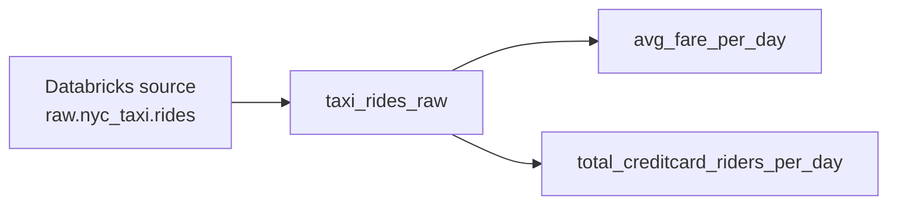
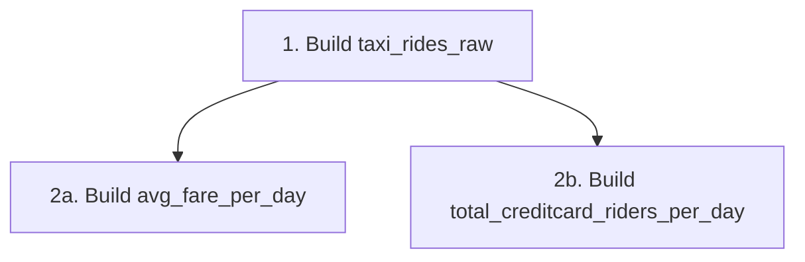

# Hierarchical Models and Lineage in dbt

A dbt project becomes a hierarchy when models depend on sources and other models. dbt records these relationships as a directed acyclic graph (DAG), then uses the graph to build models in a valid order and display data lineage.

## What a dbt hierarchy represents

A hierarchy answers two related questions:

* **Dependency:** What must exist before this model can be built?
* **Lineage:** Where did this model's data come from, and what uses it downstream?

Consider a Databricks taxi pipeline. A staging model prepares the raw rides, and two downstream models calculate daily metrics:



Both daily models depend on `taxi_rides_raw`, so dbt must successfully build `taxi_rides_raw` before either downstream model can run.

## Why the graph is directed and acyclic

The graph is **directed** because each arrow has a direction:

```text
upstream dependency → downstream consumer
```

It is **acyclic** because a chain of models cannot loop back to its starting point. For example, this would be invalid:

```text
model_a → model_b → model_a
```

Neither model could be built first because each one would require the other to exist.

## Defining dependencies with `source()` and `ref()`

dbt discovers most dependencies from Jinja calls inside project files:

* `source()` points to raw data declared as a dbt source.
* `ref()` points to another model, seed, or snapshot managed by dbt.

### Referencing a Databricks source

If `raw.nyc_taxi.rides` is an existing Databricks table loaded by another system, declare it as a source in YAML:

```yaml
version: 2

sources:
  - name: nyc_taxi
    catalog: raw
    schema: nyc_taxi
    tables:
      - name: rides
```

The staging model then uses `source()` instead of hardcoding the three-part relation name:

```sql
-- models/staging/taxi_rides_raw.sql
select
    ride_date,
    fare_amount,
    payment_type
from {{ source('nyc_taxi', 'rides') }}
```

This creates the first dependency:

```text
source: nyc_taxi.rides → taxi_rides_raw
```

### Referencing an upstream model

The average-fare model refers to the staging model by its dbt model name:

```sql
-- models/marts/avg_fare_per_day.sql
select
    ride_date,
    avg(fare_amount) as avg_fare
from {{ ref('taxi_rides_raw') }}
group by ride_date
```

The credit-card model uses the same upstream model:

```sql
-- models/marts/total_creditcard_riders_per_day.sql
select
    ride_date,
    count(*) as total_creditcard_riders
from {{ ref('taxi_rides_raw') }}
where payment_type = 'credit_card'
group by ride_date
```

Each `ref()` call creates an edge in the DAG. dbt also replaces it with the fully qualified relation for the active Databricks target. In development, this could compile to:

```sql
from development.magan_dev.taxi_rides_raw
```

The SQL model refers to the stable dbt name, while dbt decides the actual catalog and schema.

## How dbt uses the DAG during a run

When `dbt run` starts, dbt parses the project, builds the dependency graph, compiles the model SQL, and executes models in dependency order.

For the taxi example, the order is:



After `taxi_rides_raw` succeeds, the two downstream models are eligible to run in parallel because neither depends on the other.

The transcript says models would otherwise run alphabetically, but that is not a safe assumption. Without `ref()` or another declared dependency, dbt treats the models as independent and may run them concurrently. If one model secretly relies on another through a hardcoded name, the downstream model could run too early or read an outdated relation.

## Hardcoded relation versus `ref()`

This query may work if the relation already exists:

```sql
select *
from development.magan_dev.taxi_rides_raw
```

However, dbt cannot infer from that hardcoded name that the current model depends on the dbt model `taxi_rides_raw`.

Using `ref()` provides several benefits:

```sql
select *
from {{ ref('taxi_rides_raw') }}
```

* dbt records the dependency.
* The models run in the correct order.
* The lineage graph includes the relationship.
* The relation resolves for the active development or production target.
* Renaming a catalog or schema does not require changing every downstream query.

## Selecting models through the graph

The DAG can also help select related models. To run `taxi_rides_raw` and all of its downstream models, add the graph operator after its name:

```bash
dbt run --select taxi_rides_raw+
```

To run `avg_fare_per_day` together with all of its upstream dependencies, place the operator before its name:

```bash
dbt run --select +avg_fare_per_day
```

These selectors are useful when testing a connected portion of the Databricks pipeline rather than the entire project.

## DAG versus folder structure

The folders under `models/` help people organize the project, but they do not define execution order by themselves.

```text
models/
├── staging/
│   └── taxi_rides_raw.sql
└── marts/
    ├── avg_fare_per_day.sql
    └── total_creditcard_riders_per_day.sql
```

The actual dependency order comes from `ref()`, `source()`, and other dependency declarations. Folder names such as `staging` and `marts` are useful conventions, not instructions to run one folder before another.

## Key takeaways

* A dbt hierarchy is the dependency DAG connecting sources, models, and other resources.
* `source()` creates a dependency on declared source data.
* `ref()` creates a dependency on another dbt-managed resource and resolves its relation name.
* dbt runs upstream models before their downstream consumers.
* Independent models may run in parallel; dbt does not simply rely on alphabetical order.
* Folder structure organizes files, while references define the real DAG.
* Graph selectors make it possible to run a model with its ancestors or descendants.
