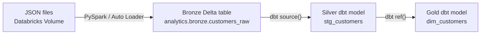

# dbt Sources in a Databricks Medallion Architecture

A dbt source is a named declaration for data that already exists and is managed outside dbt. In this Databricks medallion architecture, JSON files first land in a Volume, PySpark turns them into Bronze Delta tables, and dbt declares those Bronze tables as its sources before transforming them into Silver and Gold models.

## The ownership boundary

The pipeline has a clear handoff point:



In this design:

* **Databricks Volume** stores the landed JSON files.
* **PySpark or Auto Loader** reads those files and creates or updates Bronze Delta tables.
* **Bronze** preserves the raw payload and ingestion metadata.
* **dbt sources** point to the Bronze tables; they do not create them.
* **Silver dbt models** parse, type, clean, and deduplicate the Bronze records.
* **Gold dbt models** apply business logic for reporting and analytics.

**Critical Rule:** A source declaration creates metadata in the dbt project, not a physical Databricks table.

## Landing files are not the dbt source in this design

Suppose customer JSON arrives at:

```text
/Volumes/landing/crm/customers/*.json
```

A Databricks Volume is file storage governed through Unity Catalog. Although Databricks can query files directly, this architecture deliberately places a Bronze Delta table between the files and dbt.

That means the handoff to dbt is:

```text
analytics.bronze.customers_raw
```

not the Volume path itself.

This gives dbt a stable table interface even if the landing files, ingestion schedule, or file-handling logic change.

## Creating the Bronze table with PySpark

One approach is to preserve each line-delimited JSON record as a string in `payload` and add ingestion metadata. The following simplified Auto Loader example assumes one JSON object per line:

```python
from pyspark.sql import functions as F

landing_path = "/Volumes/landing/crm/customers"
checkpoint_path = "/Volumes/checkpoints/crm/customers"
schema_path = "/Volumes/checkpoints/crm/customers_schema"
bronze_table = "analytics.bronze.customers_raw"

raw_json = (
    spark.readStream
    .format("cloudFiles")
    .option("cloudFiles.format", "text")
    .option("cloudFiles.schemaLocation", schema_path)
    .load(landing_path)
)

bronze_customers = raw_json.select(
    F.col("value").alias("payload"),
    F.col("_metadata.file_path").alias("source_file"),
    F.col("_metadata.file_modification_time").alias("source_modified_at"),
    F.current_timestamp().alias("ingested_at"),
)

(
    bronze_customers.writeStream
    .option("checkpointLocation", checkpoint_path)
    .trigger(availableNow=True)
    .toTable(bronze_table)
)
```

This PySpark process—not the source YAML—creates and loads the Bronze Delta table.

A simplified Bronze structure could look like:

| Column | Purpose |
|:---|:---|
| `payload` | Original JSON record stored as text |
| `source_file` | Volume file from which the record came |
| `source_modified_at` | Modification time reported for the source file |
| `ingested_at` | Time the ingestion process handled the record |

The exact metadata columns are a design choice. Other useful fields could include a batch ID, ingestion job ID, source system, or rescued-data column.

## Declaring the Bronze table as a dbt source

Once `analytics.bronze.customers_raw` exists, declare it under `sources:` in a YAML property file beneath a configured model path:

```text
models/
└── staging/
    └── customers/
        ├── _customers__sources.yml
        └── stg_customers.sql
```

The source declaration maps dbt's logical names to the physical Unity Catalog relation:

```yaml
version: 2

sources:
  - name: bronze
    description: Raw Delta tables produced by the Databricks ingestion layer.
    catalog: analytics
    schema: bronze
    tables:
      - name: customers_raw
        description: >
          Customer JSON payloads and ingestion metadata loaded from the landing
          Volume by PySpark Auto Loader.
        columns:
          - name: payload
            description: Original JSON record stored as text.

          - name: source_file
            description: Full path of the landed file that contained the record.

          - name: source_modified_at
            description: Modification timestamp reported for the landed file.

          - name: ingested_at
            description: Timestamp when the record entered the Bronze table.
```

The logical source name `bronze` does not have to match the catalog or schema. It is simply the first argument used by `source()`.

## Accessing the Bronze table with `source()`

The Jinja function takes the logical source and table names:

```sql
{{ source('bronze', 'customers_raw') }}
```

dbt resolves that expression to the physical Databricks relation:

```sql
analytics.bronze.customers_raw
```

It also creates a lineage dependency between the Bronze table and the dbt model that uses it.

## Parsing Bronze data into a Silver model

The first dbt model can parse the raw JSON payload, assign data types, and expose the ingestion metadata. Databricks' `from_json` function turns the string into a struct using an explicit schema:

```sql
-- models/staging/customers/stg_customers.sql
with bronze as (
    select
        payload,
        source_file,
        source_modified_at,
        ingested_at
    from {{ source('bronze', 'customers_raw') }}
),

parsed as (
    select
        from_json(
            payload,
            'customer_id string, first_name string, last_name string, email string, updated_at timestamp'
        ) as customer,
        source_file,
        source_modified_at,
        ingested_at
    from bronze
)

select
    customer.customer_id,
    customer.first_name,
    customer.last_name,
    customer.email,
    customer.updated_at,
    source_file,
    source_modified_at,
    ingested_at
from parsed
```

The model can then be materialized into the Silver layer according to the project's configuration.

In production, the medallion layout might be:

```text
analytics.bronze.customers_raw    ← PySpark-owned source table
analytics.silver.stg_customers    ← dbt model
analytics.gold.dim_customers      ← dbt model
```

During development, dbt should redirect model outputs into a personal development location rather than overwrite shared production Silver or Gold tables. The shared Bronze source can remain read-only.

## Building Gold models with `ref()`

Once `stg_customers` is created by dbt, it is no longer treated as an external source. Downstream models use `ref()`:

```sql
-- models/marts/customers/dim_customers.sql
select
    customer_id,
    concat(first_name, ' ', last_name) as full_name,
    email,
    updated_at
from {{ ref('stg_customers') }}
```

The resulting lineage is:

```text
Volume JSON files
      ↓ PySpark
source('bronze', 'customers_raw')
      ↓ dbt
ref('stg_customers')
      ↓ dbt
dim_customers
```

## Testing the Bronze source

Generic data tests can be attached to the Bronze source in the same YAML declaration.

At this layer, test stable ingestion guarantees rather than Silver business rules:

```yaml
version: 2

sources:
  - name: bronze
    catalog: analytics
    schema: bronze
    tables:
      - name: customers_raw
        columns:
          - name: payload
            data_tests:
              - not_null

          - name: source_file
            data_tests:
              - not_null

          - name: ingested_at
            data_tests:
              - not_null
```

For example, uniqueness of `customer_id` is usually a Silver concern because the ID still exists inside the raw JSON payload and Bronze may intentionally preserve duplicate events.

Run tests for the Bronze source table with:

```bash
dbt test --select "source:bronze.customers_raw"
```

## Testing a source with a singular test

A singular source test remains a standalone SQL file under `tests/`. It uses `source()` to query the Bronze table.

For example, this test returns empty payloads that are not technically null:

```sql
-- tests/assert_customer_payload_not_empty.sql
select
    payload,
    source_file,
    ingested_at
from {{ source('bronze', 'customers_raw') }}
where trim(payload) = ''
```

The generic `not_null` test and this singular test check different failure cases.

## Mapping a physical name with `identifier`

If the physical Bronze table has an awkward name, `identifier` can keep it out of downstream dbt code:

```yaml
sources:
  - name: bronze
    catalog: analytics
    schema: bronze
    tables:
      - name: customers_raw
        identifier: raw_customer_ingestion_v2
```

The model still uses:

```sql
{{ source('bronze', 'customers_raw') }}
```

but dbt resolves it to:

```sql
analytics.bronze.raw_customer_ingestion_v2
```

## Source selection and lineage

To build every dbt model downstream of all Bronze sources, use:

```bash
dbt run --select "source:bronze+"
```

To build only models downstream of the customer source table, use:

```bash
dbt run --select "source:bronze.customers_raw+"
```

These dependencies exist because the Silver model calls `source()` and the Gold model calls `ref()`.

## `source()` versus `ref()` in this architecture

| Resource | Created by | Referenced with |
|:---|:---|:---|
| JSON files in the Volume | Landing or ingestion process | PySpark file path |
| Bronze Delta table | PySpark or Auto Loader outside dbt | `source()` |
| Silver model | dbt | `ref()` |
| Gold model | dbt | `ref()` |

If Bronze were implemented as a dbt Python model instead, dbt would own that relation and downstream models would use `ref()`. The deciding question is not just whether the object is called *Bronze*; it is whether dbt creates and manages it.

## Key takeaways

* JSON files land in a Databricks Volume before the dbt workflow begins.
* PySpark converts the files into registered Bronze Delta tables containing raw payloads and ingestion metadata.
* The Bronze Delta tables are declared as dbt sources because they already exist outside dbt.
* `source()` does not create a table; it resolves its location and adds lineage, testing, and documentation metadata.
* Silver models use `source()` to parse and clean Bronze data.
* Gold models use `ref()` because they depend on dbt-managed Silver models.
* Bronze tests should focus on ingestion guarantees, while Silver tests can validate parsed business fields.
* Whether to use `source()` or `ref()` depends on which process owns the relation.
