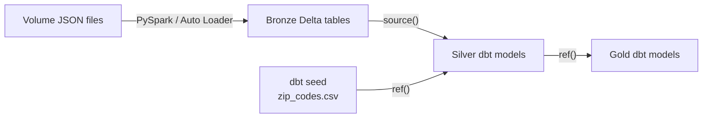

# dbt Seeds

A dbt seed is a small CSV file stored in the dbt project that dbt loads into the target data platform as a table. Seeds are best for stable reference data that belongs with the project's transformation logic—not for raw ingestion or large production datasets.

## Where seeds fit in the medallion architecture

Seeds usually sit beside the main Bronze-to-Silver-to-Gold flow as supporting reference data:



The distinction is important:

* Volume files are loaded into Bronze by the ingestion process.
* Bronze Delta tables are declared as dbt sources.
* Seed CSV files are loaded and managed by dbt.
* Both seeds and dbt models are referenced with `ref()`.

A seed is not automatically part of the Bronze layer. It is usually better viewed as a small reference or lookup table owned by the dbt project.

## Good and poor uses for seeds

Seeds work well when the data is small, rarely changes, and is safe to keep in Git.

**Good examples:**

* country or currency codes;
* postal-code mappings;
* a short list of internal test accounts;
* mappings between stable business labels and codes; and
* manually maintained classifications used by transformations.

**Poor examples:**

* raw exports from operational systems;
* large datasets;
* frequently changing transactional data;
* files produced automatically by another pipeline; and
* secrets, passwords, tokens, or sensitive personal data.

If a file is an output from an ingestion process, it normally belongs in the ingestion pipeline and Bronze layer rather than in the dbt repository as a seed.

## Why use a seed

Because a seed is a text file inside the project, it can be:

* edited with a normal text editor;
* reviewed through a pull request;
* compared with earlier Git versions;
* loaded consistently in development and production; and
* connected to the dbt DAG through `ref()`.

This is useful when a small piece of reference data is part of the project's business logic and should change together with the code that uses it.

## Creating a seed CSV

Place the CSV file under the project's `seeds` directory. The first row contains the column headers:

```text
seeds/
└── reference/
    ├── zip_codes.csv
    └── properties.yml
```

For example:

```csv
zipcode,place,state
00501,Holtsville,NY
02108,Boston,MA
94105,San Francisco,CA
```

The filename without `.csv` becomes the seed's dbt resource name:

```text
zip_codes.csv → ref('zip_codes')
```

The CSV should use a consistent number of fields in every row. Values containing commas, quotes, or line breaks must follow normal CSV quoting rules.

## Loading a seed into Databricks

Load every seed with:

```bash
dbt seed
```

Load only one seed with:

```bash
dbt seed --select zip_codes
```

dbt reads the CSV and creates a table in the active target. The exact Databricks catalog and schema depend on the target and seed configuration.

For example, the production relation might be:

```text
analytics.reference.zip_codes
```

During development, the seed should normally load into an isolated development destination instead of replacing a shared production table.

`dbt run` only runs models; it does not load seed CSV files. Use `dbt seed`, or use `dbt build` when the selected DAG includes the seed.

## Referencing a seed from a model

Seeds are dbt-managed resources, so models access them with `ref()` rather than `source()`.

For example, a Silver model can enrich customers with a place and state from the postal-code seed:

```sql
-- models/staging/customers/stg_customers_enriched.sql
select
    customers.customer_id,
    customers.full_name,
    customers.zipcode,
    zip_codes.place,
    zip_codes.state
from {{ ref('stg_customers') }} as customers
left join {{ ref('zip_codes') }} as zip_codes
    on customers.zipcode = zip_codes.zipcode
```

The two `ref()` calls create dependencies in the DAG. dbt knows the enriched customer model depends on both `stg_customers` and the `zip_codes` seed.

## Preserving leading zeros

Postal codes should be treated as identifiers, not quantities. A ZIP code such as `00501` must not become the number `501`.

If dbt infers a numeric type, leading zeros can be lost. Explicitly configure the column as a Databricks `string`:

```yaml
seeds:
  customer_analytics:
    reference:
      zip_codes:
        +column_types:
          zipcode: string
```

In this `dbt_project.yml` example:

* `customer_analytics` is the project name.
* `reference` matches the subdirectory under `seeds/`.
* `zip_codes` matches `zip_codes.csv`.
* `zipcode: string` prevents numeric inference for that column.

The same principle applies to account codes, product codes, and phone numbers: if arithmetic has no meaning, a string is usually safer than a numeric type.

## Project-wide and scoped configuration

Seed configuration can be applied at different levels in `dbt_project.yml`.

### Configuring every seed in the project

```yaml
seeds:
  customer_analytics:
    +schema: reference
    +quote_columns: false
```

This applies the `reference` custom schema and column-quoting behavior to all seeds in the `customer_analytics` project.

### Configuring one seed

```yaml
seeds:
  customer_analytics:
    reference:
      zip_codes:
        +schema: reference
        +quote_columns: false
        +column_types:
          zipcode: string
          place: string
          state: string
```

The more specific configuration applies only to `seeds/reference/zip_codes.csv`.

The final Databricks schema name may be combined with the target's default schema by dbt's schema-generation rules. Setting `+schema: reference` does not always mean the literal schema will be exactly `reference` in every environment.

## Configuring one seed in a property file

An individual seed can also receive configuration in a YAML property file:

```yaml
version: 2

seeds:
  - name: zip_codes
    description: Mapping of US ZIP codes to place and state names.
    config:
      schema: reference
      quote_columns: false
      column_types:
        zipcode: string
        place: string
        state: string
```

The syntax differs by file:

* In `dbt_project.yml`, configurations use the hierarchical resource path and normally have a `+` prefix.
* In a property file, configurations go under the seed's `config:` key without the `+` prefix.

More specific seed configuration can override broader project configuration.

Like model properties, a seed does not need a separate property file of its own. One `.yml` file can describe and test multiple seeds by listing them under `seeds:`.

## What `quote_columns` means

The `quote_columns` setting controls whether dbt quotes seed **column names** when it creates the table. It does not control CSV quoting around data values.

```yaml
config:
  quote_columns: true
```

Quoting can help when a column name contains spaces, mixed case, or a reserved word. Simple lowercase names such as `zipcode`, `place`, and `state` avoid most of these problems.

## Documenting and testing a seed

Seed properties and data tests are declared under a top-level `seeds:` key:

```yaml
version: 2

seeds:
  - name: zip_codes
    description: Mapping of US ZIP codes to place and state names.
    config:
      column_types:
        zipcode: string
    columns:
      - name: zipcode
        description: Five-character US ZIP code, including leading zeros.
        data_tests:
          - not_null
          - unique

      - name: place
        description: Place name associated with the ZIP code.
        data_tests:
          - not_null

      - name: state
        description: Two-character state abbreviation.
        data_tests:
          - not_null
```

Run the seed's tests with:

```bash
dbt test --select zip_codes
```

Or load the seed and run its tests in DAG order:

```bash
dbt build --select zip_codes
```

## Handling structural CSV changes

A normal `dbt seed` generally refreshes the table's rows while keeping its existing structure. If columns are added, removed, or renamed, rebuild the table with:

```bash
dbt seed --select zip_codes --full-refresh
```

A full refresh drops and recreates the seed table, so it should be used deliberately when the CSV structure changes.

## Running downstream models

To load `zip_codes` and build everything downstream of it, use the graph operator with `dbt build`:

```bash
dbt build --select zip_codes+
```

This selection can include the seed, dependent models, and their tests in DAG order.

## Seed versus source versus model

| Resource | Data ownership | Created by dbt? | Referenced with |
|:---|:---|:---|:---|
| Source | Existing warehouse data loaded outside dbt | No | `source()` |
| Seed | Small CSV tracked inside the dbt project | Yes, with `dbt seed` | `ref()` |
| Model | Transformation written in SQL or Python | Yes, when built | `ref()` |

In the medallion architecture:

```text
Bronze customer events → source('bronze', 'customers_raw')
Postal-code mapping    → ref('zip_codes')
Silver customer model  → ref('stg_customers')
```

## Key takeaways

* A seed is a small, rarely changing CSV file tracked inside the dbt project.
* Seeds are useful for safe reference data and small business mappings.
* Raw, large, frequently updated, or sensitive datasets should not be seeds.
* `dbt seed` loads CSV files as tables in the active Databricks target.
* Downstream models refer to seeds with `ref()`.
* Explicit string types preserve leading zeros in identifiers such as ZIP codes.
* Configure many seeds in `dbt_project.yml` or one seed through its property entry.
* Seed property files can also contain descriptions and data tests.
* Use `dbt seed --full-refresh` after structural CSV changes.
