# SCD Type 2 with dbt Snapshots

A dbt snapshot preserves historical versions of records from a relation that normally shows only the latest state. It is especially useful when an operational system overwrites customer, product, or order information but the warehouse needs to remember what those records looked like before the change.

## The main problem

Let's say an OLTP database has one row for customer `101`:

| customer_id | customer_name | city | updated_at |
|:---|:---|:---|:---|
| `101` | Ana Cruz | Manila | `2026-01-10 09:00:00` |

Ana later changes her address. The OLTP system updates the existing row:

| customer_id | customer_name | city | updated_at |
|:---|:---|:---|:---|
| `101` | Ana Cruz | Cebu | `2026-03-05 14:30:00` |

The source now tells us where Ana currently lives, but the old Manila value is gone. This becomes a problem if the sales department asks:

* Where did Ana live when she made a January purchase?
* How much revenue came from Manila in January?
* When did she move from Manila to Cebu?

A dbt snapshot turns those overwritten states into historical rows.

## What SCD Type 2 means

**SCD** means **slowly changing dimension**. *Slowly changing* does not mean that changes are predictable or extremely rare. It means dimension attributes normally change less frequently than transactional facts.

SCD Type 2 retains history by inserting another version instead of replacing the old version:

| customer_id | city | dbt_valid_from | dbt_valid_to |
|:---|:---|:---|:---|
| `101` | Manila | `2026-01-10 09:00:00` | `2026-03-05 14:30:00` |
| `101` | Cebu | `2026-03-05 14:30:00` | `null` |

Each row represents a validity interval:

```text
[dbt_valid_from, dbt_valid_to)
```

The start is included and the end belongs to the next version. By default, a null `dbt_valid_to` means that the row is the current version.


## What a dbt snapshot actually does

I like to think of a snapshot as a scheduled observer of a current-state table.

When `dbt snapshot` runs for the first time, dbt:

1. Reads the current input relation.
2. Inserts its rows into a snapshot table.
3. Adds metadata columns that describe each version.

On later runs, dbt:

1. Matches entities using the configured `unique_key`.
2. Determines whether each entity changed.
3. Closes the previous version by setting `dbt_valid_to`.
4. Inserts the changed version as the new current row.
5. Inserts entities that did not exist before.

If a record did not change, dbt does not insert another version.

Important snapshot metadata includes:

| Column | Meaning |
|:---|:---|
| `dbt_valid_from` | When this version became valid |
| `dbt_valid_to` | When this version stopped being valid; null normally means current |
| `dbt_scd_id` | Identifier generated by dbt for this particular version |
| `dbt_updated_at` | Change timestamp used internally by the snapshot |

The original business columns remain in the snapshot alongside these metadata columns.

## Where snapshots fit in the Databricks medallion pipeline

A snapshot is not automatically a Bronze, Silver, Gold, dimension, or fact table. It is a history-capture mechanism. We apply it to the earliest reliable relation that has one current row per entity and would otherwise lose earlier values.

For daily full extracts from an OLTP database, one useful design is:

```mermaid
flowchart LR
    oltp["OLTP customers table<br/>latest state only"]
    json["Daily JSON extracts<br/>Databricks Volume"]
    bronze["Bronze customer payloads<br/>append-only"]
    observations["Silver customer observations<br/>parsed and append-only"]
    current["Silver current customer<br/>one row per customer"]
    snapshot["dbt customer snapshot<br/>historical versions"]
    dimension["Gold dim_customer<br/>Kimball dimension"]

    oltp -->|"daily extract"| json
    json -->|"PySpark / Auto Loader"| bronze
    bronze -->|"parse and type"| observations
    observations -->|"keep latest observation"| current
    current -->|"dbt snapshot"| snapshot
    snapshot -->|"dimensional rules"| dimension
```



### Bronze remains append-only

Bronze can retain each JSON payload and its ingestion metadata:

| payload | source_file | extracted_at | ingested_at |
|:---|:---|:---|:---|
| Customer `101`, Manila | `customers_2026_01_10.json` | Jan 10 | Jan 10 |
| Customer `101`, Cebu | `customers_2026_03_05.json` | Mar 5 | Mar 5 |

Bronze preserves what arrived. It does not need to decide which version is current.

### Silver can contain more than one customer relation

Silver is normally a collection of purpose-specific relations rather than one giant table.

An append-only observation model can parse the JSON into typed columns:

```sql
-- models/intermediate/customers/int_customer_observations.sql
select
    customer.customer_id,
    customer.customer_name,
    customer.city,
    customer.updated_at as source_updated_at,
    extracted_at,
    ingested_at
from {{ ref('stg_customer_payloads') }}
```

A current-state model can keep only the newest observation for each customer:

```sql
-- models/intermediate/customers/int_customers_current.sql
select
    customer_id,
    customer_name,
    city,
    source_updated_at,
    extracted_at
from {{ ref('int_customer_observations') }}
qualify row_number() over (
    partition by customer_id
    order by extracted_at desc, ingested_at desc
) = 1
```

The observation relation is append-only, while the current relation exposes one latest row per customer. The current relation can be a view, so it does not necessarily create another physical copy of the data.

**Critical Rule:** Do not snapshot the complete observation ledger with `customer_id` as the unique key. It contains several customer rows at the same time. Snapshot the relation that exposes exactly one current row per unique key.

## Defining a snapshot

Current dbt versions support defining snapshots in YAML. The course's `` SQL block is the older configuration style.

The snapshot below observes the dbt-managed Silver current-customer model:

```yaml
# snapshots/customers_snapshot.yml
version: 2

snapshots:
  - name: customers_snapshot
    description: Historical versions of cleaned customer records.
    relation: ref('int_customers_current')
    config:
      database: analytics
      schema: snapshots
      unique_key: customer_id
      strategy: timestamp
      updated_at: source_updated_at
```

For the Databricks adapter, `database: analytics` identifies the catalog and `schema: snapshots` identifies the schema used for the snapshot relation.

The physical relation would be similar to:

```text
analytics.snapshots.customers_snapshot
```

Keeping snapshots in a separate schema makes their special purpose visible and helps protect historical tables from accidental deletion.

## The two change-detection strategies

The strategy answers: **How does dbt know that an entity changed?**

### Timestamp strategy

The timestamp strategy uses one reliable source column:

```yaml
config:
  unique_key: customer_id
  strategy: timestamp
  updated_at: source_updated_at
```

Use it when the OLTP system updates `source_updated_at` whenever any tracked customer attribute changes.

The contract is:

```text
tracked value changes → source_updated_at must also change
```

If the address changes but `source_updated_at` stays the same, dbt may not detect the new version.

Do not substitute `ingested_at` automatically. If every daily extract receives a new ingestion time, unchanged customers could appear to change every day.

### Check strategy

The check strategy compares selected column values:

```yaml
# snapshots/customers_snapshot.yml
version: 2

snapshots:
  - name: customers_snapshot
    relation: ref('int_customers_current')
    config:
      database: analytics
      schema: snapshots
      unique_key: customer_id
      strategy: check
      check_cols:
        - customer_name
        - city
```

Use this when the source does not provide a trustworthy update timestamp.

It is usually better to list the meaningful business columns than to check every technical metadata column. Otherwise, a new file name or ingestion timestamp could create a false business change.

| Strategy | Detects a change using | Best fit |
|:---|:---|:---|
| `timestamp` | A trustworthy `updated_at` value | Source records their modification times correctly |
| `check` | Differences in selected columns | No reliable modification timestamp exists |

## Running the snapshot

Run all snapshots with:

```bash
dbt snapshot
```

The daily pipeline must prepare the current relation before snapshotting it:

```text
1. Ingest the new JSON extract into Bronze.
2. Refresh the required Silver models.
3. Run dbt snapshot while the new current state is visible.
4. Build the downstream Gold dimensions and facts.
```

Snapshots should be scheduled as part of the production workflow rather than relying on a developer to run them manually.

A snapshot is intentionally history-preserving. Passing `--full-refresh` does not make dbt drop and recreate the snapshot table as it would for an ordinary model.

## Snapshot frequency and the states it can miss

A snapshot only records a state that exists when the command runs.

Suppose an order changes during the day:

```text
09:00 received
09:07 packed
09:20 shipped
```

If the snapshot runs at 09:01 and 09:30, it observes `received` and `shipped` but may never see `packed`.

The run schedule should therefore match the finest history the business needs:

* Daily history needed → a daily snapshot may be enough.
* Hourly changes matter → run at least hourly.
* Every individual change must be captured → use CDC or an append-only event stream instead of relying only on polling snapshots.

With daily full JSON extracts, the warehouse cannot recover several intermediate changes that happened between extracts. If the source does not provide the exact change timestamp, validity means *when the pipeline observed the change*, not necessarily when it happened in the OLTP application.

## When a snapshot is unnecessary

If Bronze or Silver already contains every version as append-only events or CDC records, history has already been preserved. A dbt model can derive SCD2 intervals from that history without periodically snapshotting a current-state relation.

Use this decision rule:

| Input data | Recommended approach |
|:---|:---|
| One mutable current row per entity | Use a snapshot when history is required |
| Append-only events containing every change | Build history directly from the events |
| CDC inserts, updates, and deletes | Build history from the CDC records |
| Current state with no historical requirement | Use a normal Type 1 current-state model |

Snapshots are also different from Delta time travel. Delta time travel retrieves an earlier version of an entire Delta table. An SCD2 relation presents the historical versions of each business entity in a form designed for normal analytical queries.

## Building the Gold customer dimension

The snapshot contains history, but it does not have to be the final dimension. A Gold model can turn it into a governed Kimball dimension by adding:

* a stable warehouse surrogate key for each customer version;
* standardized business attributes such as sales region;
* a current-row indicator;
* an unknown-member strategy;
* only the columns intended for analytics; and
* a tested grain and contract for downstream facts.

For example:

```sql
-- models/marts/sales/dim_customer.sql
select
    sha2(
        concat_ws('|', customer_id, cast(dbt_valid_from as string)),
        256
    ) as customer_sk,
    customer_id,
    customer_name,
    city,
    case
        when city = 'Manila' then 'Metro Manila'
        when city = 'Cebu' then 'Central Visayas'
        else 'Other'
    end as sales_region,
    dbt_valid_from as valid_from,
    dbt_valid_to as valid_to,
    dbt_valid_to is null as is_current
from {{ ref('customers_snapshot') }}
```

Silver answers, **What clean customer data did we obtain from the source?** Gold answers, **How should the sales warehouse consistently represent customers for analytics?**

If a Silver relation already satisfies every dimensional requirement, it may effectively serve as the dimension. Medallion layers describe responsibilities; they do not require copying data merely to create another layer.

## Connecting the dimension to `fact_sales`

Let's say the sales fact has a grain of one row per sold product line. A January sale must connect to Ana's Manila dimension version, while an April sale must connect to her Cebu version.

The temporal lookup uses both the operational customer key and the sale time:

```sql
-- Simplified historical dimension lookup
select
    sales.sale_id,
    sales.product_id,
    customer.customer_sk,
    sales.quantity,
    sales.net_amount
from {{ ref('int_sales') }} as sales
left join {{ ref('dim_customer') }} as customer
    on sales.customer_id = customer.customer_id
    and sales.sold_at >= customer.valid_from
    and (
        sales.sold_at < customer.valid_to
        or customer.valid_to is null
    )
```

This prevents a later address change from rewriting the geographical meaning of earlier sales.

Facts usually come from append-only business events, so they normally do not need snapshots. A mutable operational object such as an order whose status is repeatedly overwritten can still be snapshot-worthy, but that decision depends on whether its state history already exists elsewhere.

## Seeds, snapshots, and dimensions

Some dimensions can come from seeds, but seeds and snapshots solve different problems:

| Resource | Purpose | Sales example |
|:---|:---|:---|
| Seed | Supplies small, controlled CSV reference data | Payment-type or country-code dimension |
| Snapshot | Captures versions from a changing external relation | Customer address or product category history |
| Model | Transforms sources, seeds, or snapshots into an analytical relation | `dim_customer` or `fact_sales` |

A small static lookup dimension may be built directly from a seed. A business-entity dimension such as customer normally originates from the operational source and may use a snapshot when old values would otherwise be lost.

## Handling deleted source rows

Deleting a customer from the current source is different from changing a column. By default, a snapshot does not treat a missing source row as a new historical state.

Modern dbt versions provide a `hard_deletes` configuration with these choices:

| Setting | Behavior |
|:---|:---|
| `ignore` | Leave the existing current snapshot version unchanged |
| `invalidate` | Close the existing version by setting `dbt_valid_to` |
| `new_record` | Add a version that explicitly records the deletion |

Deletion behavior should match the business meaning of a missing record. A temporary extraction problem should not automatically be interpreted as a deleted customer.

## Querying a snapshot

### Get current customer records

```sql
select *
from {{ ref('customers_snapshot') }}
where dbt_valid_to is null
```

### Get the complete history of one customer

```sql
select *
from {{ ref('customers_snapshot') }}
where customer_id = '101'
order by dbt_valid_from
```

### Get the version valid at a particular time

```sql
select *
from {{ ref('customers_snapshot') }}
where customer_id = '101'
  and timestamp('2026-02-15 12:00:00') >= dbt_valid_from
  and (
      timestamp('2026-02-15 12:00:00') < dbt_valid_to
      or dbt_valid_to is null
  )
```

This query returns the Manila version because it was valid on February 15.

## Important rules to remember

* Snapshot a relation only when its overwritten history matters.
* The snapshot input must return one current row per `unique_key`.
* Test that the configured key is genuinely unique.
* Prefer the timestamp strategy when the source has a reliable modification timestamp.
* Do not treat ingestion metadata as a business change without thinking through the result.
* Run snapshots after the latest ingestion and upstream transformations are ready.
* The schedule controls which states dbt can observe; it cannot recover states missed between runs.
* If append-only events or CDC already preserve every change, build history from them instead.
* Snapshots often feed dimensions, but the snapshot is not automatically the final Gold dimension.
* Keep snapshot tables protected because dropping them destroys accumulated history.
